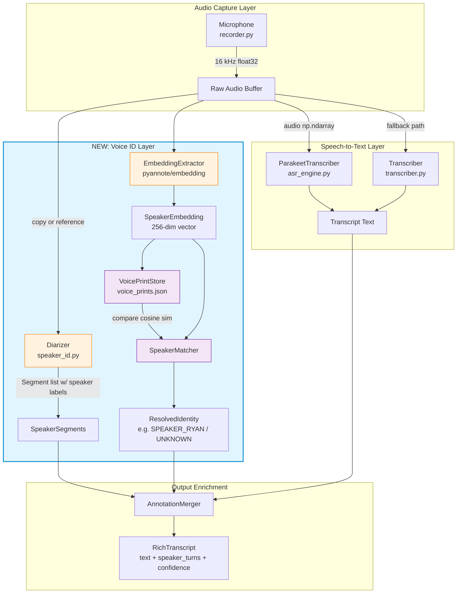
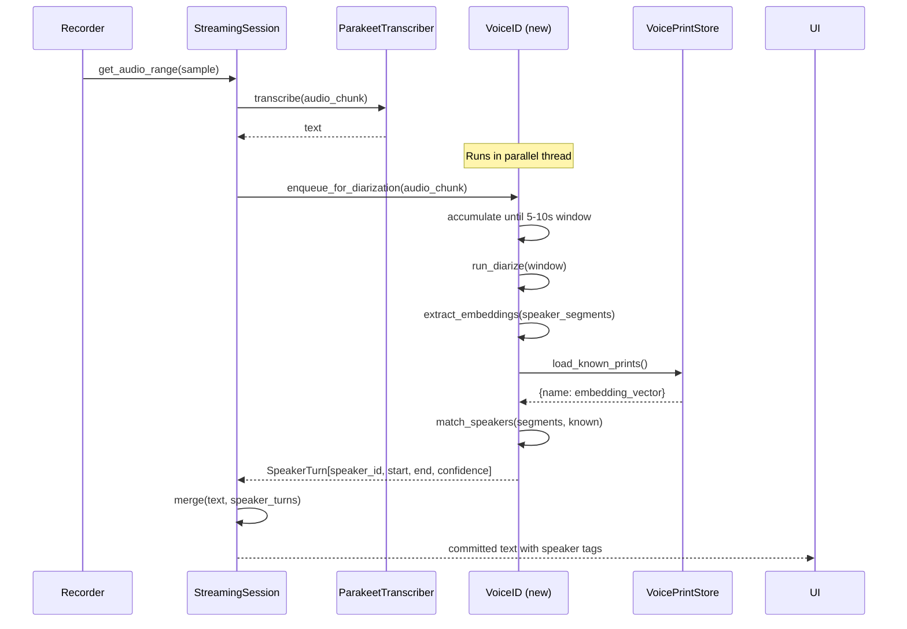
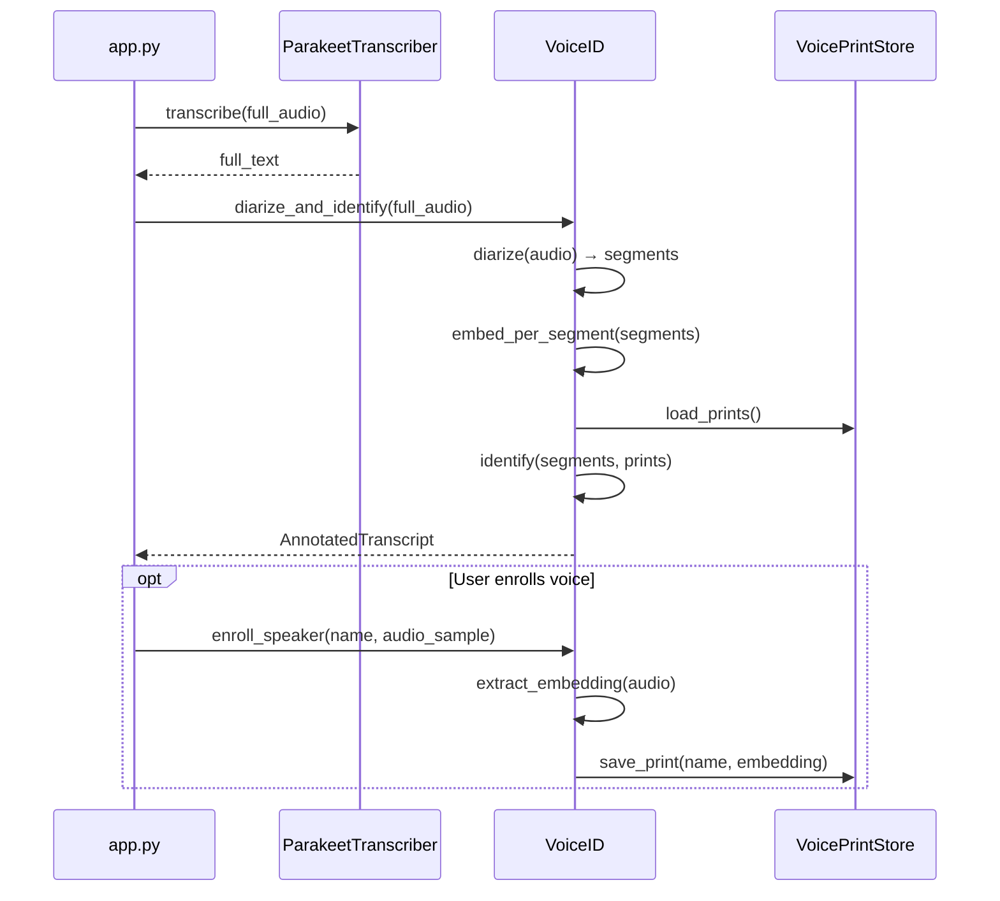

# Voice Identification & Speaker Recognition — Design Document

**Project:** BrightLink Echo  
**Status:** Design Phase (no production code)  
**Date:** 2026-10-23  
**For:** Integration with existing `asr_engine.py` / `transcriber.py` / `stream_session.py`

---

## 1. Executive Summary

BrightLink Echo currently transcribes speech via **Parakeet TDT 0.6b** (primary, ONNX) or **faster-whisper** (fallback), but has **no speaker awareness** — every dictation is treated as anonymous audio. This design adds two capabilities:

1. **Speaker Diarization** (who spoke when) — using **pyannote Community-1 pipeline** or **NVIDIA Sortformer**
2. **Long-term Speaker Identity Memory** (recognise "Ryan" vs someone else) — via speaker embeddings stored locally

### Why pyannote over Sortformer for this use case

| Criterion | pyannote Community-1 | NVIDIA Sortformer |
|-----------|---------------------|-------------------|
| Max speakers | Unlimited (clustering-based) | Fixed at 4 |
| Desktop dictation fit | ✅ Scales to meetings | ⚠️ Caps at 4 |
| Speaker embeddings | ✅ Built-in (WeSpeaker ResNet34) | ❌ Not exposed |
| CPU inference | ✅ Well-supported | Optimised for GPU |
| Model size | ~150 MB segmentation + embedding | ~400 MB |
| Production readiness | ✅ Battle-tested API + local | Research-oriented toolkit |
| License | MIT / custom per-checkpoint | NVIDIA Open Model |

**Recommendation:** Use **pyannote.audio** as the primary diarization engine with its built-in speaker embedding extraction for identity memory. Sortformer can be added later as an optional fast-path for noisy environments if needed.

---

## 2. Architecture Overview



---

## 3. Data Flow

### 3.1 Real-time Dictation Flow (Streaming)



### 3.2 Batch / History Retry Flow



---

## 4. Component Design

### 4.1 Diarizer (`speaker_id.py` — new file)

**Responsibility:** Split audio into per-speaker time segments.

```python
# Pseudocode — structure only, not production code

class Diarizer:
    """Wraps pyannote diarization pipeline for BrightLink Echo."""
    
    def __init__(self, model_path: str = None, device: str = "cpu"):
        # Lazy-load pyannote.pipeline.Pipeline
        # Accept HuggingFace token for gated model access
        ...
    
    def diarize(self, audio: np.ndarray, sample_rate: int = 16000) -> list[SpeakerTurn]:
        """
        Returns list of SpeakerTurn(start, end, speaker_label, confidence).
        
        Speaker labels are temporary: SPEAKER_00, SPEAKER_01, etc.
        Resolution to names happens in SpeakerMatcher.
        """
        ...

@dataclass
class SpeakerTurn:
    start: float          # seconds
    end: float            # seconds  
    speaker_label: str    # e.g. "SPEAKER_00"
    confidence: float     # 0.0–1.0
```

**Key decisions:**
- **Minimum audio length:** 3 seconds of speech for reliable diarization; shorter clips skip diarization silently
- **Windowing:** For streaming, accumulate audio in 5-10 second windows with 2s overlap
- **Threading:** Diarizer runs on its own daemon thread; never blocks the ASR hotpath
- **Fallback:** If pyannote fails to load or times out (>2s for a typical dictation chunk), return empty list — transcription proceeds without speaker labels

### 4.2 EmbeddingExtractor (`speaker_id.py`)

**Responsibility:** Convert audio segments into comparable 256-dim vectors.

```python
class EmbeddingExtractor:
    """Extracts speaker embeddings using pyannote/embedding (WeSpeaker)."""
    
    MODEL_DIM = 256  # WeSpeaker ResNet34-LM output dimension
    MIN_SPEECH_S = 2.0  # minimum seconds of speech for reliable embedding
    
    def __init__(self, model_path: str = None, device: str = "cpu"):
        # Load pyannote/audio Inference model
        # Uses "whole" window mode for enrollment
        # Uses "sliding" window mode for segment matching
        ...
    
    def extract(self, audio: np.ndarray, sample_rate: int) -> np.ndarray:
        """
        Returns (1, 256) float32 numpy array — L2-normalized.
        Returns None if audio too short or no speech detected.
        """
        ...
    
    def extract_from_segment(
        self, 
        audio: np.ndarray, 
        sample_rate: int, 
        start_s: float, 
        end_s: float
    ) -> np.ndarray:
        """Extract embedding from a time range within longer audio."""
        ...
```

**Model choice:** `pyannote/embedding` (WeSpeaker ResNet34-LM)
- **Dimension:** 256
- **EER on VoxCeleb1:** 2.8% (cosine similarity, no PLDA)
- **Size:** ~80 MB
- **License:** Requires HuggingFace acceptance + token

### 4.3 VoicePrintStore (`voice_print_store.py` — new file)

**Responsibility:** Persist and retrieve speaker identity data.

#### Storage Schema

**File location:** `%APPDATA%/BrightLink Echo/voice_prints.json`

```json
{
  "version": 1,
  "schema": "voice-prints-v1",
  "created_at": "2026-10-23T10:00:00Z",
  "updated_at": "2026-10-23T14:30:00Z",
  "speakers": {
    "ryan": {
      "display_name": "Ryan",
      "enrolled_at": "2026-10-23T10:05:00Z",
      "last_seen": "2026-10-23T14:30:00Z",
      "total_samples": 15,
      "embedding": null,
      "embeddings": [
        {
          "created_at": "2026-10-23T10:05:00Z",
          "duration_s": 12.5,
          "vector": [0.0123, -0.0456, ...],  // 256 floats
          "source": "enrollment",
          "device_label": "Headset USB"
        },
        {
          "created_at": "2026-10-23T12:20:00Z", 
          "duration_s": 8.3,
          "vector": [0.0131, -0.0449, ...],
          "source": "auto_confirm",
          "device_label": "Built-in Mic"
        }
      ],
      "aggregated_embedding": [0.0127, -0.0452, ...],  // mean of confirmed embeddings
      "confirmed": true,
      "confidence_history": [
        {"at": "2026-10-23T12:20:00Z", "score": 0.89},
        {"at": "2026-10-23T14:30:00Z", "score": 0.91}
      ]
    },
    "colleague_unknown": {
      "display_name": "Unknown Speaker 1",
      "enrolled_at": null,
      "last_seen": "2026-10-23T15:00:00Z",
      "total_samples": 3,
      "embedding": [0.0891, 0.0334, ...],
      "embeddings": [...],
      "aggregated_embedding": [...],
      "confirmed": false,
      "pending_name": true
    }
  },
  "settings": {
    "match_threshold": 0.75,
    "auto_enroll_min_score": 0.85,
    "auto_enroll_min_samples": 3,
    "max_stored_embeddings_per_speaker": 20,
    "require_consent": true
  }
}
```

#### Key Design Decisions

| Decision | Choice | Rationale |
|----------|--------|-----------|
| Storage format | JSON (not SQLite) | Matches existing app patterns; <100 speakers means <500KB |
| Embedding storage | Multiple + aggregated | Enables re-aggregation when new samples arrive; guards against drift |
| Encryption | Optional AES-256-GCM | Voiceprints are biometric data; encrypt-at-rest for privacy |
| Sync | Opt-in cloud backup | Mirror to user's BrightLink account like audio_store |

```python
class VoicePrintStore:
    """Persistent store for speaker identities and their voice embeddings."""
    
    FILENAME = "voice_prints.json"
    DEFAULT_THRESHOLD = 0.75  # cosine similarity threshold for positive match
    
    def __init__(self, data_dir: str = None):
        # data_dir defaults to roaming_dir() from data_paths.py
        ...
    
    # -- queries ----------------------------------------------------------
    
    def get_all_speakers(self) -> dict[str, SpeakerProfile]: ...
    def get_speaker(self, speaker_id: str) -> Optional[SpeakerProfile]: ...
    def get_aggregated_embeddings(self) -> dict[str, np.ndarray]: ...
    
    # -- mutations --------------------------------------------------------
    
    def save_embedding(
        self, 
        speaker_id: str, 
        embedding: np.ndarray, 
        duration_s: float,
        source: str = "auto",
        device_label: str = ""
    ) -> None: ...
    
    def confirm_speaker(self, speaker_id: str, display_name: str) -> None: ...
    def rename_speaker(self, speaker_id: str, display_name: str) -> None: ...
    def delete_speaker(self, speaker_id: str) -> None: ...
    def purge_unconfirmed(self, older_than_days: int = 30) -> None: ...
    
    # -- persistence ------------------------------------------------------
    
    def load(self) -> None: ...
    def save(self) -> None: ...
    def _encrypt(self, plaintext: bytes) -> bytes: ...   # optional
    def _decrypt(self, ciphertext: bytes) -> bytes: ...  # optional


@dataclass
class SpeakerProfile:
    speaker_id: str
    display_name: str
    enrolled_at: Optional[str]
    last_seen: str
    total_samples: int
    embeddings: list[StoredEmbedding]
    aggregated_embedding: Optional[np.ndarray]
    confirmed: bool
    pending_name: bool  # True when we've seen this voice but user hasn't named it


@dataclass  
class StoredEmbedding:
    created_at: str
    duration_s: float
    vector: np.ndarray     # (256,) float32, L2-normalized
    source: str            # "enrollment" | "auto_confirm" | "dictation"
    device_label: str
```

### 4.4 SpeakerMatcher (`speaker_id.py`)

**Responsibility:** Compare segment embeddings against known voiceprints and resolve identities.

```python
class SpeakerMatcher:
    """Matches speaker segments to known identities via cosine similarity."""
    
    def __init__(self, store: VoicePrintStore, threshold: float = None):
        ...
    
    def identify(
        self, 
        segments: list[SpeakerTurn], 
        segment_embeddings: dict[str, np.ndarray]
        # key = speaker_label (SPEAKER_00), value = (256,) embedding
    ) -> list[IdentifiedSpeaker]:
        """
        For each segment's embedding, compute cosine similarity against all
        confirmed speakers' aggregated_embeddings.
        
        Returns IdentifiedSpeaker with resolved name or UNKNOWN.
        """
        ...
    
    def _cosine_similarity(self, a: np.ndarray, b: np.ndarray) -> float: ...
    
    def _should_auto_enroll(self, score: float, speaker_id: str) -> bool: ...


@dataclass
class IdentifiedSpeaker:
    turn: SpeakerTurn
    resolved_name: Optional[str]  # "Ryan" or None if unknown
    match_score: Optional[float]  # 0.0–1.0, or None if no matches exist
    is_new_speaker: bool         # True if this voice doesn't match any known speaker
    suggested_name: Optional[str]  # e.g. "Unknown Speaker 2"
```

**Matching algorithm:**

```
For each segment_embedding E:
    best_score = 0
    best_match = None
    
    For each confirmed speaker S with aggregated embedding A:
        score = cosine_similarity(E, A)
        if score > best_score:
            best_score = score
            best_match = S
    
    if best_score >= threshold:
        → Identity = best_match.display_name, confidence = best_score
    else:
        → Identity = UNKNOWN, is_new_speaker = True
        if score > auto_enroll_threshold AND speaker has N+ samples:
        → Create pending SpeakerProfile, prompt user to name
```

---

## 5. Integration Points with Existing Code

### 5.1 Integration with `asr_engine.py` (ParakeetTranscriber)

**Location:** `ParakeetTranscriber.transcribe()` method (~line 456)

**What changes:**
- After `_recognize_long()` returns text but before `_post_process()`, optionally run diarization on the same audio
- Append speaker metadata to return value (extend the method's output contract)

```python
# EXISTING signature (asr_engine.py:456)
def transcribe(
    self, audio: np.ndarray, sample_rate: int = 16000, blocking: bool = True,
    context_words: str = "", hotwords_str: str = "",
    conf_out: Optional[list] = None,
) -> str:

# PROPOSED extension — add optional speaker_out parameter
def transcribe(
    self, audio: np.ndarray, sample_rate: int = 16000, blocking: bool = True,
    context_words: str = "", hotwords_str: str = "",
    conf_out: Optional[list] = None,
    speaker_out: Optional[list] = None,  # NEW: append (start, end, speaker, score) tuples
) -> str:
```

**Non-breaking:** `speaker_out` defaults to `None`; when `None`, behaviour is identical to today. Only callers that pass a list receive speaker data.

### 5.2 Integration with `transcriber.py` (Whisper fallback)

Same pattern — add optional `speaker_out` parameter to `Transcriber.transcribe()` and `_run()`.

### 5.3 Integration with `stream_session.py` (StreamingSession)

**Location:** The `_tick()` worker loop and `finalize()` method

**What changes:**
- When VoiceID is enabled, each committed chunk is also queued for diarization
- Speaker labels arrive asynchronously and are merged into the committed text on next tick
- Final `finalize()` call blocks briefly for any pending diarization to complete

```python
# In StreamingSession.__init__(), add:
self._voice_id: Optional[VoiceIDSession] = None
self._speaker_labels: dict[float, str] = {}  # sample_offset -> speaker_name

# In _tick(), after committing text:
if self._voice_id:
    self._voice_id.enqueue_audio(committed_audio, committed_sample_offset)

# New method:
def set_voice_id(self, voice_id_session: 'VoiceIDSession') -> None:
    """Enable speaker identification for this streaming session."""
    self._voice_id = voice_id_session
```

### 5.4 Integration with `app.py` (Main Application)

**Where VoiceID is instantiated:**

```python
# In app.py startup (alongside recorder, transcriber, etc.):
from speaker_id import VoiceIDSession, Diarizer, EmbeddingExtractor, SpeakerMatcher
from voice_print_store import VoicePrintStore

self._voice_store = VoicePrintStore()
self._voice_store.load()

# Lazily initialized on first use (avoids loading ~230MB of models at startup
# unless the feature is enabled):
self._voice_id: Optional[VoiceIDSession] = None

def _get_voice_id(self) -> Optional[VoiceIDSession]:
    if self._voice_id is None and self.config.voice_id_enabled:
        self._voice_id = VoiceIDSession(
            store=self._voice_store,
            diarizer=Diarizer(...),
            embedder=EmbeddingExtractor(...),
            matcher=SpeakerMatcher(self._voice_store),
        )
    return self._voice_id
```

### 5.5 Integration with `voice_training.py` (Existing Voice Training)

**Synergy:** The existing `VoiceTrainer` uploads raw audio clips to BrightLink Notetaker for server-side learning. The new VoiceID system is **complementary and local-first**:

| Aspect | Existing voice_training.py | New VoiceID System |
|--------|---------------------------|-------------------|
| Purpose | Server-side adaptation | Local speaker recognition |
| Data sent | Raw WAV clips | Nothing (local-only) |
| Model location | Server (Notetaker) | Local (this machine) |
| Output | Better transcription accuracy | Speaker labels + identity |
| Consent | Required (server toggle) | Local setting |

**Potential integration:** When `voice_training.py` uploads a clip that was already identified as the owner's voice, include the `speaker_id` metadata so the server can associate the voice model with the correct user account.

---

## 6. Required Packages & Dependencies

### 6.1 Core Dependencies (must add to build)

| Package | Version | Purpose | Size | License |
|---------|---------|---------|------|---------|
| `pyannote.audio` | ≥3.1.0 | Diarization pipeline | ~50 MB pip | MIT |
| `pyannote.embedding` | latest | WeSpeaker embedding model | ~80 MB | Custom (HF gated) |
| `torch` | ≥2.0 (CPU) | Backend for pyannote | ~200 MB CPU only | BSD-3 |
| `torchaudio` | ≥2.0 | Audio processing for torch | ~10 MB | BSD-3 |
| `scipy` | ≥1.10 | Cosine distance computation | Already shipped | BSD |
| `huggingface_hub` | ≥0.20 | Model download/auth | Already shipped? | Apache-2.0 |

### 6.2 Model Checkpoints (downloaded at first use, not bundled)

| Model | HuggingFace Path | Size | Access |
|-------|-----------------|------|--------|
| Segmentation | `pyannote/segmentation-3.0` | ~70 MB | Gated (accept terms) |
| Speaker Embedding | `pyannote/embedding` | ~80 MB | Gated (accept terms) |
| Diarization Pipeline | `pyannote/speaker-diarization-community-1` | Config only | Gated |

### 6.3 PyInstaller Considerations

Current bundle strategy (from `asr_engine.py` docstring): models are **not** bundled in the exe. They're downloaded at runtime to `%LOCALAPPDATA%\BrightLink Echo\models\`.

**Same approach for VoiceID models:**
- `pyannote` models download on first use via `huggingface_hub`
- Store under `%LOCALAPPDATA%\BrightLink Echo\models\voice-id\`
- SHA-256 pinning following the same pattern as Parakeet models
- Atomic renames, `.part` files for crash safety

**Hidden import additions for PyInstaller spec:**
```
hiddenimports=[
    ...existing...,
    'pyannote',
    'pyannote.audio', 
    'pyannote.core',
    'pyannote.pipelines',
    'torch',
    'torchaudio',
    'huggingface_hub',
]
```

**Bundle size impact:**
- `torch` CPU-only adds ~200 MB to the installer
- This is significant — consider making VoiceID an **optional feature module** that's downloaded/installed separately, or lazy-loaded so the import only happens when enabled

---

## 7. Implementation Plan

### Phase 1: Foundation (Week 1–2)

| Task | File(s) | Description |
|------|---------|-------------|
| 1.1 | `voice_print_store.py` | Implement `VoicePrintStore` with JSON persistence, load/save, encryption stub |
| 1.2 | `speaker_id.py` | Implement `EmbeddingExtractor` wrapping `pyannote/embedding` |
| 1.3 | `speaker_id.py` | Implement basic `SpeakerMatcher` with cosine similarity |
| 1.4 | Tests | Unit tests for store CRUD, embedding shape, matching thresholds |

**Deliverable:** Can extract a 256-dim embedding from a WAV file and store/retrieve it.

### Phase 2: Diarization (Week 2–3)

| Task | File(s) | Description |
|------|---------|-------------|
| 2.1 | `speaker_id.py` | Implement `Diarizer` wrapping `pyannote.pipeline.Pipeline` |
| 2.2 | `speaker_id.py` | Implement `VoiceIDSession` orchestrator class |
| 2.3 | `asr_engine.py` | Add optional `speaker_out` param to `ParakeetTranscriber.transcribe()` |
| 2.4 | `transcriber.py` | Add optional `speaker_out` param to `Transcriber.transcribe()` |
| 2.5 | Tests | Integration test with known 2-speaker audio file |

**Deliverable:** Transcribing a 2-person conversation returns labelled segments.

### Phase 3: Streaming Integration (Week 3–4)

| Task | File(s) | Description |
|------|---------|-------------|
| 3.1 | `stream_session.py` | Add `set_voice_id()` and async label queue |
| 3.2 | `app.py` | Wire up `VoiceIDSession` creation, config flag |
| 3.3 | Settings UI | Toggle for VoiceID, threshold slider, speaker management |
| 3.4 | Tests | Mock diarizer, test stream session doesn't block |

**Deliverable:** Live dictation shows "[Ryan:]" prefix when voice is recognised.

### Phase 4: Identity Memory & Enrollment (Week 4–5)

| Task | File(s) | Description |
|------|---------|-------------|
| 4.1 | UI | "Train your voice" wizard — 3 × 10s recordings |
| 4.2 | `speaker_id.py` | Auto-enrollment logic for unknown speakers |
| 4.3 | `voice_print_store.js` | Aggregation, re-computation of mean embedding |
| 4.4 | UI | Speaker management panel — rename, delete, confirm |
| 4.5 | Tests | End-to-end: enroll → dictate → recognise |

**Deliverable:** Full cycle: user enrolls, dictates later, system recognises them.

### Phase 5: Polish & Edge Cases (Week 5–6)

| Task | Description |
|------|-------------|
| 5.1 | Handle model download failures gracefully (feature off, not crash) |
| 5.2 | Voice drift detection — if match score drops below threshold, prompt re-enrollment |
| 5.3 | Multi-device handling — same person on headset vs laptop mic produces different embeddings (store per-device or device-agnostic) |
| 5.4 | Performance budget — diarization must not add >500ms latency to dictation commit |
| 5.5 | Privacy — encrypt voice_prints at rest, clear consent flow |
| 5.6 | Documentation — update README, settings tooltips |

---

## 8. Configuration

### New Settings Keys (in existing config system)

```python
# In the app's config/settings:
voice_id_enabled: bool = False        # Master switch
voice_id_match_threshold: float = 0.75  # Cosine similarity threshold
voice_id_auto_enroll: bool = True     # Auto-create profiles for unknown voices
voice_id_label_transcript: bool = True # Show "[Name]:" prefixes in output
voice_id_min_speech_s: float = 3.0    # Min speech for diarization attempt
voice_id_models_downloaded: bool = False  # Cached state
```

### Environment Variables (for development)

```bash
PYANNOTE_HF_TOKEN=hf_xxxx        # HuggingFace token for gated models
VOICE_ID_DEBUG=1                 # Extra logging
VOICE_ID_SKIP_DIARIZATION=1      # Force-disable for testing
```

---

## 9. Risk Mitigation

| Risk | Impact | Mitigation |
|------|--------|------------|
| `torch` bloats installer by ~200MB | Large download | Lazy import; download torch only when VoiceID first enabled; consider `torch` CPU-only subset |
| pyannote model download fails | Feature unavailable | Graceful fallback to no-speaker-info mode; retry on next launch |
| Diarization too slow for streaming | Committed text delayed | Run asynchronously; speaker labels arrive on NEXT dictation, not current one |
| False positives in speaker matching | Wrong attribution | Conservative threshold (0.75); require 3+ confirming samples before auto-naming |
| Voice changes over time (cold, illness) | Match score drops | Store multiple embeddings; use rolling mean; prompt re-enrollment if score < 0.6 |
| Privacy concerns about biometric data | User distrust | Local-only storage by default; encryption at rest; clear documentation; easy deletion |
| HuggingFace token required for gated models | Friction on setup | Token fetch during onboarding; cache securely; fallback message if missing |

---

## 10. Testing Strategy

### Unit Tests

- `test_voice_print_store.py`: CRUD operations, aggregation, encryption round-trip, schema validation
- `test_embedding_extractor.py`: Output shape (1, 256), L2 normalisation, None on short input
- `test_speaker_matcher`: Known pairs score >0.8, different speakers score <0.5, threshold boundary

### Integration Tests  

- `test_diarizer.py`: 2-speaker test WAV → correct segment count, reasonable timings
- `test_voice_id_session.py`: End-to-end audio-in, annotated-transcript-out
- Test fixtures: Pre-recorded WAV files with ground-truth speaker labels (can be synthesized with TTS + mixing)

### Regression Tests

- Existing `asr_engine` tests must pass unchanged (speaker_out=None path)
- Streaming session timing must not regress (diarizer off = zero overhead)
- Memory footprint: VoiceID disabled = no torch imported = no memory change

---

## 11. Future Enhancements (Out of Scope for Initial)

1. **Sortformer integration** — As a faster alternative diarizer for GPU-equipped machines
2. **Cloud voiceprint sync** — Share identities across user's machines via BrightLink account
3. **Real-time streaming diarization** — Using pyannote's online/incremental mode for live meetings
4. **Anti-spoofing** — Detect replay attacks with simple countermeasures (random phrase challenge)
5. **Multi-language support** — Current pyannote models are language-agnostic; ensure non-English dictation works
6. **Speaker-adaptive ASR** — Feed recognised speaker ID into Parakeet/Whisper for per-speaker language model adaptation

---

## Appendix A: File Manifest (New Files)

```
BrightLink Echo/
├── speaker_id.py              # Diarizer, EmbeddingExtractor, SpeakerMatcher, VoiceIDSession
├── voice_print_store.py       # VoicePrintStore, SpeakerProfile, StoredEmbedding dataclasses
├── docs/
│   └── DESIGN_voice_id.md     # This document
└── tests/
    ├── test_speaker_id.py     
    └── test_voice_print_store.py
```

## Appendix B: Modified Files

| File | Change |
|------|--------|
| `asr_engine.py` | Add `speaker_out` param to `ParakeetTranscriber.transcribe()` |
| `transcriber.py` | Add `speaker_out` param to `Transcriber.transcribe()` |
| `stream_session.py` | Add `VoiceIDSession` integration, async speaker labels |
| `app.py` | Instantiate VoiceID, wire to sessions, config flags |
| `brand.py` | No changes (no new on-disk names needed) |
| `data_paths.py` | No changes (reuse `roaming_dir()`) |

## Appendix C: Glossary

| Term | Definition |
|------|------------|
| **Diarization** | The task of determining "who spoke when" — splitting audio into per-speaker segments |
| **Voice Print / Voiceprint** | A fixed-size numerical vector (embedding) that uniquely characterises a speaker's voice |
| **Embedding** | A compressed representation of audio (or other data) as a vector in high-dimensional space |
| **Cosine Similarity** | A measure of vector similarity: cos(θ) = (A·B) / (‖A‖‖B‖); ranges -1 to 1; >0.75 typically indicates same speaker |
| **EER** | Equal Error Rate — the threshold where false acceptance rate equals false rejection rate; lower is better |
| **pyannote** | Open-source toolkit for speaker diarization by Anthony et al.; now also a commercial API (pyannote.ai) |
| **Sortformer** | NVIDIA's end-to-end neural diarization model using arrival-time sorting; max 4 speakers |
| **WeSpeaker** | Speaker embedding model (ResNet34-LM) used by pyannote for voiceprint extraction |
